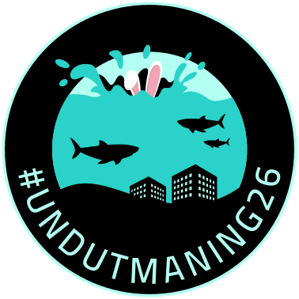
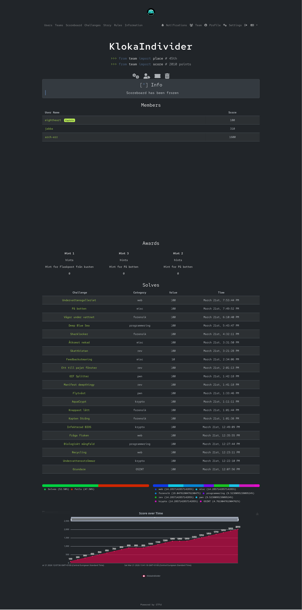

  

# UndUtmaning 2026

**CTF-Link:** [undutmaning.se](https://undutmaning.se)

**Username:** `arch-err`

**Team:** `KlokaIndivider`

**Result:** 45th / 435 teams — 2010 points, 21/25 challenges solved

## Description

> *Swedish CTF by FRA, MUST, SÄPO. 25 challenges, 8 hours (12:00–20:00 CET)*

## Challenges

### Forensik
- [x] [Knappast lätt](./challs/forensik/Knappast%20lätt)
- [x] [Kapten Sträng](./challs/forensik/Kapten%20Sträng)
- [x] [Sharklocker](./challs/forensik/Sharklocker)
- [x] [Vågor under vattnet](./challs/forensik/Vågor%20under%20vattnet)

### Krypto
- [x] [Undervattensströmmar](./challs/krypto/Undervattensströmmar)
- [x] [AquaCrypt](./challs/krypto/AquaCrypt)
- [x] [Infekterad BIOS](./challs/krypto/Infekterad%20BIOS)

### Web
- [x] [Recycling](./challs/web/Recycling)
- [x] [Fråga fisken](./challs/web/Fråga%20fisken)
- [x] [Undervattensgalleriet](./challs/web/Undervattensgalleriet)
- [ ] [Code Control](./challs/web/Code%20Control)

### PWN
- [x] [Flytväst](./challs/pwn/Flytväst)
- [x] [GIF Splitter](./challs/pwn/GIF%20Splitter)

### Rev
- [x] [Skattkistan](./challs/rev/Skattkistan)
- [x] [Manifest deepthingy](./challs/rev/Manifest%20deepthingy)
- [x] [Ett till pajat fönster](./challs/rev/Ett%20till%20pajat%20fönster)

### OSINT
- [x] [Grundare](./challs/osint/Grundare)
- [ ] [Flaskpost från kusten](./challs/osint/Flaskpost%20från%20kusten)

### Misc
- [x] [Feedbackutmaning](./challs/misc/Feedbackutmaning)
- [x] [På botten](./challs/misc/På%20botten)
- [x] [Åtkomst nekad](./challs/misc/Åtkomst%20nekad)
- [ ] [Back off man! I'm a scientist.](./challs/misc/Back%20off%20man!%20I'm%20a%20scientist.)
- [ ] [echo](./challs/misc/echo)

### Programmering
- [x] [Biologiskt mångfald](./challs/programmering/Biologiskt%20mångfald)
- [x] [Deep Blue Sea](./challs/programmering/Deep%20Blue%20Sea)

## Results

